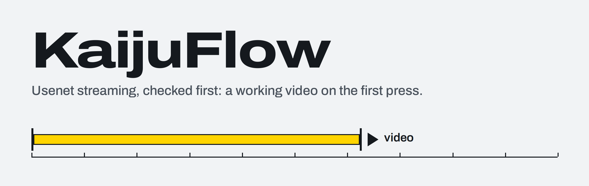

<p>
  <picture>
    <source media="(prefers-color-scheme: dark)" srcset="docs/assets/readme/banner-dark.png">
    <source media="(prefers-color-scheme: light)" srcset="docs/assets/readme/banner-light.png">
    
  </picture>
</p>

# KaijuFlow

[](https://github.com/ReyesPascal/KaijuFlow/actions/workflows/ci.yml)

Private, self-hosted Usenet discovery, verification, fallback, and original-quality streaming for Stremio, based on the complete Usenet Ultimate v1.4.1 release.

KaijuFlow checks a Source's health, so the title you press is the one that plays, and hands it to AltMount, its one Backend, to stream. Every change is measured on Brain against KaijuFlow's own previous run: first no fails, then the fastest time from title to video.

It started from that release: the backend, React UI and media assets, search and indexer integrations, NNTP providers, Smart and Fixed health checks (deleted in #191: KaijuFlow checks a Source when it is played), archive inspection, automatic fallback, caches, installation scripts, and Docker tooling. It streams through AltMount alone; NzbDAV streaming was removed (#188). See [UPSTREAM.md](UPSTREAM.md) for provenance and licensing.

## Getting started

### 1. Build it

<details>
<summary><strong>Node.js 20, from the preserved lockfiles</strong></summary>

Use an isolated development environment with Node.js 20, as used by the upstream Docker build.

```sh
npm ci
npm run build
cd ui
npm ci
npm run build
```

</details>

### 2. Test it

<details>
<summary><strong>Unit, integration and brain-tool tests</strong></summary>

```sh
npm run test:unit
npm run test:integration   # commit first: it rebuilds dist/ from committed code
npm run test:a4
npm run check:brain        # the speed-check tools: compile, lint, tests
```

Use fabricated credentials and synthetic fixtures for testing. The things the scripts don't tell you are in [docs/agents/testing.md](docs/agents/testing.md).

</details>

### 3. Set it up

<details>
<summary><strong>Installation and setup</strong></summary>

Setup and deployment details remain in the original [INSTALLATION.md](INSTALLATION.md) and [SETUP.md](SETUP.md); the original release README is preserved [verbatim](docs/upstream/README.v1.4.1.md).

Keep provider credentials, indexer keys, private configuration, logs, and runtime data out of Git.

</details>

## The speed check

<details>
<summary><strong>How KaijuFlow is measured</strong></summary>

- What a run is and how it is judged, and the words it uses: [tools/brain/docs/rules.md](tools/brain/docs/rules.md) and [GLOSSARY.md](GLOSSARY.md), "Measuring"; spec #183 replaced most of [ADR 0007](docs/adr/0007-speed-tests-play-as-at-home.md) (its amendment of 2026-11-20).
- How a run is made: [tools/brain/RUNBOOK.md](tools/brain/RUNBOOK.md); the tools: [tools/brain/README.md](tools/brain/README.md).
- The plan: spec [#58](https://github.com/ReyesPascal/KaijuFlow/issues/58); the speed-test build: spec [#159](https://github.com/ReyesPascal/KaijuFlow/issues/159); KaijuFlow with AltMount, fast and lean: spec [#183](https://github.com/ReyesPascal/KaijuFlow/issues/183) (the map since 2026-11-20).
- The latest results: the [Speed Check page](https://claude.ai/artifact/VUydiLAYH9gbJ63FtXk3qD).

</details>

## Working on it

<details>
<summary><strong>Where to start a session</strong></summary>

- [CLAUDE.md](CLAUDE.md) points at everything an agent needs; [docs/agents/resume.md](docs/agents/resume.md) is how a session resumes.
- What can start now: `python3 -I tools/brain/frontier.py` (the tickets of spec #58 with no open blocker).
- Decisions: [docs/adr](docs/adr/).

</details>

## Project records

- [Roadmap and acceptance gates](docs/kaijuflow/ROADMAP.md)
- [Audit findings and development decisions](docs/kaijuflow/AUDIT.md)
- [Next session](docs/kaijuflow/audit/NEXT_SESSION.md)
- [Source manifest](docs/kaijuflow/upstream-v1.4.1-manifest.json) and [validation evidence](docs/kaijuflow/import-verification.json)

Brain and its working containers and streaming configuration are outside this development task. No production deployment is authorized.

## License

The original upstream [MIT license](LICENSE), copyright (c) 2026 Usenet Ultimate Contributors, is preserved exactly at the root. The previous ReyesPascal MIT notice is preserved [separately](docs/kaijuflow/LICENSE.ReyesPascal), on `archive/pre-upstream-import`, and in Git history.
