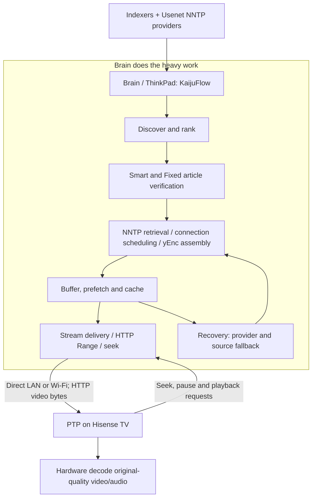

# CURRENT HANDOFF — A4 CLOSED; ONE POST-A4 INTEGRATION PASSED (2026-11-07)

This section overrides all historical next-action instructions below. Audit branch: `audit/node20-a3-baseline`. Original app pin `c83a3c733b6394eb140a1c0a1dc500010a9f22e5`; test implementation commit `ad402bcec957184bfdde91644dc5d00a06e6a7ea`. The documentation commit containing this handoff advances the head; verify GitHub for its exact SHA.

- **A4 officially closed** as bounded synthetic validation. [Closure report](A4-CLOSURE.md): existing run [42372236463](https://github.com/ReyesPascal/KaijuFlow/actions/runs/42372236463), job `128402557244`; 15 backend PASS/2 intentional RED, 3 React PASS/1 intentional RED, 3 coordinator PASS, 2 cache PASS. Source hashes and fail-closed isolation passed. Latest delete-all fixture received204; it does not independently establish the earlier503 claim. Known defect families remain record-only: destructive HEAD, failed-delete dedup, stale React autosave success. Do not add A4 tests or fix source.
- **Exactly one new scenario**, `INT-DISCOVERY-STREAM-001`, [passed](INTEGRATION-DISCOVERY-STREAM.md) run [42373119985](https://github.com/ReyesPascal/KaijuFlow/actions/runs/42373119985), job `128405137873`: original composed parser/results/coordinator/builder/stream preparation/route/proxy delivered HTTP200 and64exactbytes; SHA256 `2f487e40e16653113a45fe0c0621d2b36e4bb2aac192a5169570977adfae9d95`. Fake NzbDAV, supplied health verdict, full server/auth/search orchestration bypass and synthetic128MiB metadata for64bytes are explicit limits. No playable media, real service or4K claim. Stop synthetic expansion.
- Test implementation Node20 CI [42373119948](https://github.com/ReyesPascal/KaijuFlow/actions/runs/42373119948), job `128405137497`, PASS; evidence index [42373119978](https://github.com/ReyesPascal/KaijuFlow/actions/runs/42373119978), job `128405137752`, PASS. Final documentation/index CI is recorded in Issue #2 after this commit; verify latest head before future work.
- Permanent references: [NNTP](../references/nntp/README.md), [NzbDAV](../references/nzbdav/README.md); [live-validation gaps](VALIDATION_GAPS.md). Evidence IDs EV-KF-A4-CLOSURE-001, EV-KF-INT-001, EV-KF-REF-001 indexed with sanitized permanent result JSON.
- Separate performance milestone [Issue #4](https://github.com/ReyesPascal/KaijuFlow/issues/4), [benchmark plan](../performance/BENCHMARK_PLAN.md): planning only. Preserve known-good NzbDAV until measured alternatives prove superior. Production benchmarks, deployment, Brain access/configuration changes and implementation are not authorized.
- Closed A4 and completed integration workflows are now manual-only to prevent repeated cases on documentation commits. Existing push/PR triggers automatically scheduled prior suites during the integration checkpoint; no additional A4 cases were added and no manual A4 rerun was requested.
- Issue #2 remains OPEN handoff tracker; PR #1 and draft PR #3 remain OPEN/UNMERGED. Both repos private; original source and Brain unchanged.

**Next authorized milestone:** review/refine the separate performance plan only; execution requires a separately scoped non-production environment/corpus authorization. Do not restart A3/A4, run REA, fix defects, merge PRs or contact Brain. Real provider throughput/recovery, actual NzbDAV processing, original4K playback/TTFF, seeking/buffering/concurrency and full archive compatibility remain unverified.

---

# LATEST VERIFIED GATE — COORDINATOR + CACHE RESTART/RECOVERY (2026-11-07)

Owner instruction: document existing defects only; **do not fix app source**, merge PRs or touch Brain production.

**Current verified audit head before this handoff commit:** `0db27d54119faec1a19cd28a1d75450a45a0acd9`; original pinned source `c83a3c733b6394eb140a1c0a1dc500010a9f22e5` unchanged. Independent [sealed A4 CI run 42372101024](https://github.com/ReyesPascal/KaijuFlow/actions/runs/42372101024), job `128402154382`:
- A4 coordinator cases **3 PASS, 0 FAIL** (Smart early stop with pre-existing cached verdicts, Fixed top-N, disabled health checks).
- Added separate-process stream cache cases **2 PASS, 0 FAIL**:
  - `A4-CACHE-RESTART-021`: original compiled streamCache ready/dead states persisted, then recovered in a fresh process: both writer/reloader `ready=true, dead=true, readyCount=1, deadCount=1`. Important source contract: `addDeadNzbByUrl` caller invokes `saveCacheToDisk()`; earlier fixture omission was corrected without source changes.
  - `A4-CACHE-CORRUPT-022`: both cache files overwritten with invalid synthetic JSON, subsequent process loaded zero entries without crashing.
- Existing backend cases **15 PASS / 2 intentional RED**, existing React cases **3 PASS / 1 intentional RED**, unchanged. Combined A4 workflow conclusion remains **red intentionally** because original deletion and React assertions are not fixed.
- A4 fail-closed namespace and immutable original source SHA-256 before/after passed; only disposable mock URLs and files used. CI report includes `a4-coordinator-results.json` and `a4-cache-results.json`.
- Evidence index [run 42372101054](https://github.com/ReyesPascal/KaijuFlow/actions/runs/42372101054) PASS on above head; Node20 build CI should be checked on newest head for final claim.

**Verified new cases this session: five additional passes, zero new confirmed application defects.** All additions in `tests/a4/`, isolated runner/workflow and audit docs only. Important remaining unverified work: full Newznab discovery-to-playback E2E, real NNTP/NzbDAV behaviors under streaming load, HTTP byte-body and seek/disconnect integration, archive compatibility, longer recovery/persistence cases, resource use and 4K performance comparisons. Synthetic coordinator probes do not establish actual NNTP reachability or 4K parity. Avoid repeating already-passed fixtures. Any live benchmark touching Brain requires separate explicit production-impact approval. Keep PR #1 and PR #3 open/unmerged.

**Resume:** Verify the latest audit head and CI, proceed only with genuinely uncovered isolated end-to-end cases, and document blockers/remaining live-performance gates. Preserve all intentional red assertions, source identity and production safety.

---

# LATEST VERIFIED GATE — SMART/FIXED COORDINATOR SYNTHETIC EXECUTION (2026-11-07)

**Owner's overriding instruction remains: record known defects only; no source fixes, production changes, or PR merges.**

Audit branch `audit/node20-a3-baseline@ac3d49f25ac9e59578176d504bcf3c557bebb3ac` added review-only `tests/a4/coordinator.mjs` and sealed runner/artifact wiring (source `src/` and `ui/src/` untouched). Independently checked [A4 GitHub Actions 42371578806](https://github.com/ReyesPascal/KaijuFlow/actions/runs/42371578806), job `128400633529`: **three newly added coordinator cases PASS / zero new failures**:
- `A4-COORD-SMART-018` PASS: original compiled `coordinateHealthChecks` stops after first healthy Smart batch with pre-existing synthetic results; Zyclops verification and library-origin retention observed.
- `A4-COORD-FIXED-019` PASS: original compiled coordinator Fixed top-N=2 with pre-existing statuses; later Zyclops auto-marked and library-origin result retained.
- `A4-COORD-DISABLED-020` PASS: checks disabled, Zyclops auto-verification and library-origin retention.

Execution used original sealed disposable network namespace and fake data; recorded `A4 COORD SUMMARY {"passed":3,"failed":0}`. Prior backend `15 PASS / 2 intentional RED`, React `3 PASS / 1 intentional RED` reproduced in the same run. Original source SHA-256 before/after identical. **The A4 CI conclusion is intentionally failure** due to existing deletion and React behavior findings, not a coordinator regression. Evidence-index CI [42371578804](https://github.com/ReyesPascal/KaijuFlow/actions/runs/42371578804) passed on this head; Node20 status on the same commit should be rechecked before making a new claim.

**Scope caveat:** Cached-verdict coordinator control flow only; does not prove live Smart/Fixed NNTP orchestration, Newznab discovery-to-stream E2E, long-running cache restart/corruption, seek/disconnect byte correctness under full integration, or 4K comparative performance. These are separate unverified validation gates, not evidence that current application source is incorrect. Keep known original behavior findings recorded without remediation.

**Next safe gate:** Add genuinely missing isolated E2E protocol fixtures only, in small bounded commits with same fail-closed gate, or document not executable without permissions. Real NzbDAV/NNTP performance or production-coupled benchmarks require separately scoped explicit approval; do not contact Brain or real providers automatically. No repeated settled A4 cases; preserve draft PR #3, import PR #1 unmerged and main unchanged.

---

# OWNER DECISION — DOCUMENT DEFECTS, DO NOT FIX (2026-11-07)

**Explicit latest user instruction:** "dont try to fix anything just make a note about it". This supersedes any prior handoff suggestion to prepare/implement fixes. **Do not edit application source, create remediation patches, propose fixes as the next required task, or merge either PR.** Preserve the audit-only scope and move efficiently through unfinished validation/documentation if requested.

Known, test-observed application behaviors are **record-only**:
1. Destructive library-delete GET route is also invoked by HEAD and triggers fake WebDAV DELETE (A4-DELETE-003).
2. Failed 503 single-delete and delete-all operations are incorrectly deduplicated on immediate replay rather than retried (A4-DELETE-003 / A4-DELETEALL-007).
3. Older successful React autosave PUT responses can overwrite newer shared config state (A4-REACT-ORDER).

The corresponding deliberately red assertions remain intact. **Do not try to resolve them now.** Do not misrepresent them as fixed; distinguish synthetic reproduction from real-production frequency. Existing reports and source-linked findings remain canonical. The user wants speed: skip completed synthetic A4 fixtures, focus only on genuine uncovered validation if continuing; record limitations without making source modifications.

As of prior independent verification: isolated A4 42370377554, backend 15 PASS / 2 intentionally RED, React 3 PASS / 1 intentionally RED. Evidence and Node 20 CI were green at head `695dbcff01577459ac1c3a770ea720f6a79de25d`; A4 remained red by design. Confirm new head/CI before fresh claims. Preserve original source/import, Brain production, private repos, and unmerged PR #1/#3.

**Next-session prompt:** Resume KaijuFlow from Issue #2 and the top of NEXT_SESSION.md. Honor owner decision: **document the three confirmed defects only, do not fix anything**. Verify latest audit branch/CI, avoid repeating completed A4 tests, and finish only unverified isolated validation/evidence tasks quickly. Leave original source, Brain production, and both PRs untouched.

---

# CURRENT HANDOFF — expanded A4 synthetic matrix executed and indexed (2026-11-07)

**Verified:** Original immutable app at `c83a3c733b6394eb140a1c0a1dc500010a9f22e5`; draft PR #3 stays open/unmerged against open/unmerged import PR #1. CI [A4 run 42370377554](https://github.com/ReyesPascal/KaijuFlow/actions/runs/42370377554), job `128397091476`: `synthetic.mjs` **15 PASS / 2 intentional RED**, React `3 PASS / 1 intentional RED`. Original source hash checks and fail-closed no-egress gate passed. Expanded evidence: [A4-ADDITIONAL-SYNTHETIC-2026-11-07.md](A4-ADDITIONAL-SYNTHETIC-2026-11-07.md), indexed `EV-KF-A4-EXPANDED-017`, `CL-KF-A4-EXPANDED-017`, `ART-KF-A4-EXPANDED-017`. Final evidence/Node20 CI on new documentation/index commits must be rechecked.

**Completed, do not repeat:** Auth/SDK, sequential settings and actual React 300ms/error scenarios; deletion and delete-all failed-503 replay; provider and manual indexer CRUD/reorder; Prowlarr/NZBHydra sync; local NNTP authentication/STAT provider fallback; split archive grouping and yEnc BODY; synthetic health pipeline sampleCount 3 and 7 with missing-article block; WebDAV 200/206/416 + fallback and one-shot cache markers. An additional manual indexer CRUD fixture repeats coverage and should not count as a new subsystem.

**Outstanding actual application defects (red by design):** destructive library-delete GET auto-handling HEAD; unsuccessful single and delete-all WebDAV 503 being deduped instead of retried; real useAppConfig stale successful PUT response overwriting newer shared config state. None are fixed in original source, and failures should remain visible until separately approved remedies. The 15 successful tests establish bounded synthetic module behavior, not real-4K streaming parity or comprehensive Smart/Fixed UI orchestration.

**Next gate:** Verify this handoff/index commit's evidence-index and Node20 CI; inspect synthetic job changes if another worker advanced audit branch; do not redo passed A4 tests. Prepare a separate source-fix review plan only with user permission. Never modify Brain production, credentials, original source `src/` or `ui/src/`, merge PRs, or weaken sandbox. Maintain rollback branch.

**Resume prompt:** Resume KaijuFlow from Issue #2 and the top of NEXT_SESSION.md. Verify latest audit head and CI. Expanded A4 synthetic matrix is verified at run 42370377554 (15 PASS, two intentional deletion RED; separate React ordering RED). Inspect any new changes, verify evidence-index CI, and prioritize reviewing proposed fixes for the three original behavior defects without changing original source or production or merging either PR.

---

# VERIFIED A4 CI CHECKPOINT — November 7, 2026

The latest independently reviewed isolated A4 run is [42370377554](https://github.com/ReyesPascal/KaijuFlow/actions/runs/42370377554), job `128397091476` at audit commit `17822864583a09917b65c46aaaeae02b67e9e1e6`. Permanent [case-by-case report](A4-CI-VERIFIED-2026-11-07.md).

- **15 backend PASS, 2 deliberately RED**: full synthetic provider CRUD, indexer CRUD, synced indexers, fake NNTP handshake, STAT fallback, archive grouping, yEnc, Range/proxy, cache, health sampling, auth/SDK and backend settings all executed successfully. Single-delete and delete-all 503/HEAD behavior faults remain red.
- **React 3 PASS / 1 intentionally RED**: debounce, HTTP 500, transport error pass; older success response overwrites newer shared config.
- A4 isolation gate remained PASS with no network egress and source SHA-256 unchanged. Evidence-index CI passed for preceding head [42370377549](https://github.com/ReyesPascal/KaijuFlow/actions/runs/42370377549). Recheck CI on new documentation commits.
- The earlier duplicate `registerDeleteAllTargets` declaration in our added test was caught by isolated run 42370253462; corrected audit-only by `17822864`. Do not claim the earlier syntax-failing run executed backend synthetic assertions.
- Both PR #1 and draft PR #3 remain unmerged. Neither original application source nor Brain production changed.

**Next action:** Confirm fresh head CI and validator, avoid repeating settled fixtures, triage the three original behavior defects as owner-approval-required source fixes, and plan missing broader integration/performance coverage separately. There is no claim of full A4 production parity or live 4K verification. Keep original source immutable until user authorizes fixes.

---

# ACTIVE A4 CHECKPOINT — executed new tests (2026-11-07)

**Source of truth:** [A4 additional synthetic CI report](A4-ADDITIONAL-SYNTHETIC-2026-11-07.md). Audit-only code head `1699e435af9a41f7f0f243a652fcc5def1a798dd` was independently executed in GitHub Actions [A4 42369608369](https://github.com/ReyesPascal/KaijuFlow/actions/runs/42369608369): **six synthetic.mjs cases PASS, two FAIL desired safety invariants** (single delete and delete-all). Separate original React stale-autosave success response remains intentionally RED, previously verified. Node20 [42369608375](https://github.com/ReyesPascal/KaijuFlow/actions/runs/42369608375) PASS; evidence validator [42369608614](https://github.com/ReyesPascal/KaijuFlow/actions/runs/42369608614) PASS. Recheck CI after this documentation commit.

**New verified:** A4-DELETEALL-007 failed 503 DELETE is not retried on immediate replay (attempt count 1→1), while missing token and invalid manifest cause zero remote DELETE; A4-PROVIDER-005 CRUD/reorder PASS using in-memory callbacks; A4-INDEXER-006 manual indexer CRUD/timeout/URL normalization/caps callback PASS; A4-NNTP-HANDSHAKE-008 original test endpoint PASS against fake 200/381/281 AUTHINFO socket on loopback. This is not real provider/indexer syncing, Smart/Fixed article verification, or throughput.

**Next tasks, in order:** (1) real synchronized indexer pathways; (2) Smart and Fixed article/STAT/provider fallback; (3) archive/yEnc parsing; (4) HTTP Range 200/206/416, cache and proxy/fallback. Extend `tests/a4/synthetic.mjs` or add bounded test files wired into existing sealed CI; avoid repeating passed tests. Record exact CI runs and findings. Keep intentionally RED behavior findings untouched. **Never modify original source or Brain production, merge PR #1/#3, use live NNTP/indexer credentials, or disable the isolation gate.**

**Resume prompt:** Resume KaijuFlow from Issue #2 and the top of NEXT_SESSION.md. Verify latest audit branch CI; continue outstanding A4 synchronized indexer, Smart/Fixed STAT and provider, archive/yEnc, Range/cache/fallback tests in the isolated GitHub-hosted fixture. Preserve source, existing red findings, and both unmerged PRs; save small evidence commits.

---

# ACTIVE NEXT-SESSION HANDOFF — finish remaining A4 quickly (2026-11-07)

**User direction:** Focus exclusively on completing and validating the remaining KaijuFlow A4 work as efficiently as safely possible. Do not surface or carry forward previously discussed optional architecture concepts in progress reports, priorities or future-session prompts. Historical handoffs below are retained only as provenance; this section overrides them.

## Independently verified current GitHub state
- PR #1 open/unmerged: `import/upstream-v1.4.1@c83a3c733b6394eb140a1c0a1dc500010a9f22e5`, targeting unchanged `main@1d35e9088f7abb5a8b907605b4b06a8960557540`.
- PR #3 open/draft/unmerged: `audit/node20-a3-baseline@3021941c86afed3b31026683feda4490c128cf52` when checked; new documentation commit will advance this head.
- On that audit head, evidence index [42368490168](https://github.com/ReyesPascal/KaijuFlow/actions/runs/42368490168) PASS and Node20 build [42368490167](https://github.com/ReyesPascal/KaijuFlow/actions/runs/42368490167) PASS. A4 [42368490134](https://github.com/ReyesPascal/KaijuFlow/actions/runs/42368490134) FAILED as expected due to original behavioral safety invariants. Do not treat intentionally red tests as environment-isolation failure; inspect logs if outcomes change.
- Immutable original source retained; all changes are audit/test/docs/evidence only.

## Completed — do not repeat
- A4-ISO-000 fail-closed disposable namespace/egress denial; JWT/auth A4-HTTP-001; Stremio SDK route A4-SDK-002; backend sequential settings subcase.
- Expanded A4-DELETE-003 tests: path traversal, bad packs/envelopes, invalid manifest, concurrency executed. **Two original defects remain test-observed and intentionally RED:** destructive HEAD; unsuccessful WebDAV DELETE marked deduplicated for immediate replay.
- Actual original `useAppConfig` React hook executed under isolated CI [42368292063](https://github.com/ReyesPascal/KaijuFlow/actions/runs/42368292063): 300ms debounce PASS; HTTP 500 and rejected transport response retain local edits PASS; **response-order safety invariant FAIL** — old successful PUT response overwrites shared `config` with stale cacheTTL=9300 after newer 9400, while local edit remains 9400. This is verified synthetic client-state behavior, not proof of server persistence order. [Finding](../../../evidence/findings/F-KF-A4-AUTOSAVE-001.md), evidence IDs `EV-KF-A4-REACT-004`, `CL-KF-A4-REACT-RACE-004`, `ART-KF-A4-REACT-004`. Do not rebuild or rerun solved static A3/import for redundancy.

## Fastest safe next sequence
1. Extend current isolated `tests/a4/synthetic.mjs` with **delete-all 503 replay** using fake localhost WebDAV. Distinguish expected red source behavior from fixture failures; record request count and auth/validation boundaries.
2. Add **provider CRUD/reorder + synced-indexer** synthetic fixtures against original compiled handlers, while preserving existing fail-closed gate.
3. Add **Smart/Fixed and provider NNTP** fixtures using fake Article/STAT responses and invented test credentials; no external host connections.
4. Add **archive/yEnc** synthetic fixtures and **NzbDAV HTTP Range 200/206/416, cache, fallback/proxy** cases. Prefer compact bounded increments, one committed checkpoint per tested group.
5. Check new-head CI and exact job logs after changes; write source-pinned results to `docs/kaijuflow/audit/` and evidence-index JSONL, run validator, leave failures visibly red. Update Issue #2 with each verified gate. Keep a fresh top-of-file handoff and exact resume prompt.

**Safety:** Never change original `src/` or `ui/src/`, working Brain production, containers, volumes, secrets, credentials or networking. No live NZBs, provider connections, PR merges, force pushes, or production deployment. Separate source fixes require approval.

**Resume prompt:** Resume KaijuFlow from Issue #2 and the top of `docs/kaijuflow/audit/NEXT_SESSION.md`. Verify audit head/CI; continue A4 delete-all 503 replay, then provider/sync, Smart/Fixed NNTP, archive/yEnc, Range/cache/fallback in isolated synthetic CI. Move quickly, use incremental verified GitHub checkpoints, keep original source and production unchanged and both PRs unmerged. Do not redo completed A3 or React work.

---

# CURRENT A4 CHECKPOINT — actual React hook race independently reproduced (2026-11-07)

- **Executed** actual original React `useAppConfig` under disposable, fail-closed network namespace in [GitHub Actions run 42368292063](https://github.com/ReyesPascal/KaijuFlow/actions/runs/42368292063), job `128390937109`. Original source SHA256 before/after unchanged.
- Actual hook mounted with React test renderer and virtual timers: **A4-REACT-300 PASS**, **A4-REACT-ORDER FAIL desired ordering invariant** (two successful cacheTTL PUT response completions reversed: local 9400 but config 9300), **A4-REACT-500 PASS** local edit retained/error logged, **A4-REACT-TRANSPORT PASS** local edit retained/error logged. This is **test-observed client state race**, not a production incidence or persisted backend overwrite. Details: [F-KF-A4-AUTOSAVE-001.md](../../../evidence/findings/F-KF-A4-AUTOSAVE-001.md).
- A4 backend/auth/SDK and expanded deletion cases still reproduce earlier outcomes, with original HEAD/503 problems intentionally RED. New two-report CI artifact ID `13572687206`, ZIP SHA256 `9841987a4f2f86853e7ba0f74a108fa20f165a114b1e68776a5a4ab56d5d38ff`. Red combined CI is appropriate; independent job logs show neither isolation nor hook harness failed.
- Added only `tests/a4/react-autosave.cjs`, isolated runner/CI wiring, and evidence; no edits to `src/` or `ui/src/`, no production actions, merges, secret or real NZB use. The React runtime fixture uses ephemeral dependency install **before** gate and original hook import **after** gate.
- **Next task:** synthetic failed delete-all WebDAV retry/dedup replay, then provider CRUD/reorder, synced indexers, Smart/Fixed NNTP, archive/yEnc, HTTP Range 200/206/416, cache/fallback. Keep tests isolated and source unchanged. Explicit owner approval required before fixes.
- Preserve design target: ThinkPad/Brain does discovery, NNTP retrieval/assembly, buffering/cache/fallback; PTP/Hisense does playback UI and hardware decode over direct LAN/Wi-Fi. Benchmark NzbDAV against alternatives; do not assume new engine implemented.

---

# CURRENT VERIFIED A4 CI — expanded deletion assertions executed (2026-11-07)

- Independent GitHub Actions log review of [A4 run 42367643808](https://github.com/ReyesPascal/KaijuFlow/actions/runs/42367643808), job `128388981743`, at audit head `f1c75cefbdb62a896e6563e41ef11e028dcebeff`: isolation gate PASS; HTTP/auth PASS; SDK PASS; backend sequential settings PASS; A4 deletion intentionally RED due to **HEAD invoking remote DELETE** and **503 failed DELETE deduplication**.
- **Expanded deletion edge cases are now CI-executed, not pending**: traversal/deep-pack/malformed inputs caused zero extra remote DELETEs, invalid manifest yielded 404/zero DELETE, four concurrent same-key requests issued exactly one remote DELETE.
- Permanent exact metrics and CI artifact identity: [A4-DELETE-003-CI-VERIFICATION.md](A4-DELETE-003-CI-VERIFICATION.md). New audit-only commits advance PR #3, so verify its head and evidence-index/Node20 checks again.
- **Next actual implementation**: isolated React `useAppConfig` hook fixture with controlled 300/500ms timers, deferred/inverted-order mock PUT replies, 500 and transport failure cases; then delete-all 503 replay, provider/sync, Smart/Fixed NNTP, archive/yEnc, Range 200/206/416, cache/fallback. These remain unexecuted. Do not report React concurrency as passed.
- Keep original source pristine, preserve the intentional red behavioral findings, and retain Brain-heavy original-quality retrieval/buffering with TV hardware decode as **design**, not deployed functionality. Both PRs remain unmerged; Brain production untouched.

---

# NEXT SESSION — A4 continuation and Brain-first streaming architecture (2026-11-07)

**Live state verified at save:** audit PR #3 OPEN/DRAFT and UNMERGED at `8275ffd2fb2ae507f78ef7631fad604b86afc554`; import PR #1 OPEN/UNMERGED at immutable `c83a3c733b6394eb140a1c0a1dc500010a9f22e5`. Original upstream source is unchanged. This handoff commit will advance PR #3, so fetch the new head and CI next session.

## Immediate A4 restart
- A4-ISO-000 proven in GitHub Actions run 42366142956: disposable network namespace, loopback only, IPv4/IPv6 TCP and DNS outbound denied, fail-closed negative probe stops application imports. Existing synthetic authentication A4-HTTP-001, Stremio SDK A4-SDK-002, and sequential backend settings subtest PASSED.
- A4-DELETE-003 intentionally RED on originally observed safety invariants: HEAD on a destructive GET route initiates fake WebDAV DELETE; simulated 503 is marked handled for 30 seconds. Independent review: `docs/kaijuflow/audit/A4-DELETE-003-REVIEW.md` and `evidence/findings/F-KF-A4-DELETE-001.md`. Additional deletion assertions were committed in `tests/a4/synthetic.mjs` (traversal, invalid pack depth, malformed token, invalid manifest, four concurrent same-key requests). **Do not claim the added assertions passed until latest CI results independently confirm.** Delete-all error dedup is currently a source-supported hypothesis, not a runtime observation.
- Original React `ui/src/hooks/useAppConfig.ts` uses 300/500ms delayed autosaves; successful responses call `setConfig(data)`, errors leave local state. React timer overlap, out-of-order response, 500 rejection and retry/rollback scenarios remain untested. Existing backend sequential tests do not establish React concurrency correctness.
- **Next action sequence:** verify current branch CI/index integrity; diagnose only newly added deletion assertions (keep discovered source defects visibly RED); build isolated actual React-hook timer/inflight/failure fixture; then A4-PROVIDER-005 and A4-SYNC-006; then synthetic Smart/Fixed NNTP, archive/yEnc, Range 200/206/416, cache/fallback and proxy cases. Save source-linked evidence/index records and GitHub commits, track independently executed vs source-observed vs proposed. No repeat of import/A3 AST/Node20 baseline.

## User-requested Brain-heavy / TV-light architecture recap (design target, not implementation claim)

- Today: working Usenet Ultimate + NzbDAV baseline on Brain, PTP on Hisense, direct LAN/Wi-Fi without Tailscale proved materially more stable in earlier playback observation. The architecture above is a **proposed KaijuFlow optimization target**. Do not claim planned NNTP prefetch, direct-stream engine or replacement is implemented.
- Keep NzbDAV until measured alternative wins on startup, sustained 4K bitrate, seek behavior, buffering, recovery, RAM/CPU and maintenance. Prefer original-quality passthrough and TV hardware decoding; Brain offloads discovery, network retrieval, assembly and buffering, **not necessarily video decoding/transcoding**. KaijuNNTP separate engine only with objective evidence.
- Brain / production Docker, NzbDAV volumes, passwords, networks and deployment are strictly off-limits without explicit approval. No PR merges, source rewrites, live NZBs/credentials, REA crossover or force push.

## Exact next-session prompt
> Resume KaijuFlow from GitHub Issue #2 and docs/kaijuflow/audit/NEXT_SESSION.md. Verify the current audit PR #3 head and A4 CI. Preserve the original source and both unmerged PRs. Complete expanded deletion assertions and React autosave concurrency in the proven isolated test environment; then continue remaining A4 synthetic cases. Save GitHub evidence/index checkpoints. Keep the Brain-heavy original-quality streaming design as a future benchmarking target, without touching Brain production.

---

# CURRENT A4 CONTINUATION — deletion review and expanded regression committed (2026-11-07)

**Verified live PR #3 head at session start:** `0d4f229a395e9ac2ea8eedd67585f13c6c41456d`; audit-only follow-up commits `f838c16f` (test expansion) and `ef72f276` (independent review). **Recheck current head and latest GitHub Actions before claiming execution.** Both PR #1 and draft PR #3 remain unmerged; immutable original baseline `c83a3c73` untouched.

- Independent source review recorded at [A4-DELETE-003-REVIEW.md](A4-DELETE-003-REVIEW.md). Source-confirmed: implicit HEAD on destructive GET route and pre-result 30s dedup on single and delete-all routes. Delete-all repeated-failure implication remains a **hypothesis** pending synthetic execution.
- Expanded existing network-isolated runner `tests/a4/synthetic.mjs` to check traversal, invalid pack depth, malformed envelope, invalid manifest and four simultaneous same-key requests. Existing destructive HEAD and failed 503 invariants deliberately remain red. **New checks have not yet been verified by CI at this checkpoint.**
- Previous independently executed A4-ISO-000 gate/auth/SDK/settings and deletion failures remain documented below and in run 42366142956; do not rerun the already settled static import/AST/Node20 work.
- **Immediate next:** check branch CI for `f838c16f` and later heads; diagnose only new failing assertions; then implement actual React hook 300/500ms debounce/inflight response-order/failure harness with virtual timers and fake HTTP inside proven namespace. Only after that, work through A4-PROVIDER-005, A4-SYNC-006, NNTP Smart/Fixed, archives and 200/206/416 ranges. No premature claim of React test completion, live streaming parity or security remediation.
- Preserve audit/index evidence and update Issue #2; original app source, Brain production, credentials, real NZBs, and both PR merges remain off limits.

---

# CURRENT A4 CHECKPOINT — isolated runtime gate verified / synthetic tests observed

**Date:** November 7, 2026. **Branch:** `audit/node20-a3-baseline`; verify live PR #3 head/CI because this checkpoint itself advances commit. **Source identity:** imported `c83a3c733b6394eb140a1c0a1dc500010a9f22e5` unchanged. **Both PR #1 and PR #3 remain open/unmerged.**

**Completed A4-ISO-000 and bounded HTTP tests, not full A4 parity:**
- [A4-ISO-000 report](A4-ISO-000.md), gate independently observed in GitHub-hosted [run 42366142956](https://github.com/ReyesPascal/KaijuFlow/actions/runs/42366142956): network namespace with only loopback, IPv4/IPv6 TCP and DNS denied, synthetic localhost reached, negative-control exit 77 blocked app import, pinned original source before/after hashes identical. All app code ran only after gate inside a disposable sandbox as an unprivileged user. No Brain/production access.
- Original auth router A4-HTTP-001 PASS. Actual locked SDK getRouter with dual mounts A4-SDK-002 PASS. Original backend settings router A4-AUTOSAVE-004 **backend-only subcase PASS** (disk/memory in sync for sequential valid PUT; invalid JSON 400 and oversized 413); **UI autosave timers, race/500 remain untested**.
- **A4-DELETE-003 failed desired safety invariants.** Original `GET /library-delete` Express handling triggered one fake WebDAV DELETE upon HEAD; a failed fake 503 DELETE was deduplicated on immediate retry. Reproduced with real original placeholder video assets in sandbox. See [F-KF-A4-DELETE-001](../../../evidence/findings/F-KF-A4-DELETE-001.md). The combined workflow is **RED intentionally** due to behavior failure, not isolation failure.
- Report artifact ID `13571527662`, ZIP SHA256 `0773c69cc29381259e9cf11d004a851bfecc4a09b9bcd5283ccb070ea04d9857`, expires about Nov 21. Permanent synthetic harness + report + finding + evidence index saved in Git. CI evidence-validator status must be rechecked after new commit.
- Codex and Claude Sonnet Medium completed earlier A3 source reviews; **not run during this A4 continuation**.

**NEXT:** Preserve the behavior finding as test-observed, no unauthorized source fix. Strengthen deletion HEAD/503/TTL/concurrency regression tests and independently review the safety impact; implement UI-hook 300/500ms autosave/race/rollback with fake HTTP/controlled time, and then provider/sync, Smart/Fixed, archive and Range/fallback fixtures inside the same network-denied runner. Do not rerun previous AST/Node20 import work, run REA via agents, modify Brain, merge PRs, or alter original app code. Explicit owner approval before future application-source changes and production activity.

---

# CURRENT CHECKPOINT — A3-ROUTE-003 complete as a bounded static pass / A4 design prepared

**Date:** November 7, 2026. **Latest audit head:** read live GitHub PR #3; this handoff itself advances the head. **Source:** c83a3c733b6394eb140a1c0a1dc500010a9f22e5 unchanged.

Completed this session:
- Source-only typed callback analyzer tools/audit/extract_callback_edges.cjs and .github/workflows/a3-callbacks.yml. [GitHub Actions run 42363448497](https://github.com/ReyesPascal/KaijuFlow/actions/runs/42363448497) PASS: 38 frontend files, 261 selected callback prop bindings (261 child parameters), 167 hook-return origins, 22 dynamic URL expressions, 0 parser errors/source modifications. This is bounded static relation mapping, NOT 603 complete transitive event-to-network chains. Detail: [A3-ROUTE-003.md](A3-ROUTE-003.md).
- Codex CLI 0.167.0 read-only ephemeral reviewed scoped App/useAppConfig source. Claude Code 2.1.319 Sonnet 5.5 Medium reviewed selected source excerpts with tools disabled; findings crosschecked against original source. Neither agent read REA, Fusion, related project mater…15265 tokens truncated…me-tested. `serveHTTP` helper routes are not mounted by KaijuFlow.
- **Next review gates:** resolve dynamic JSX prop/callback edges; test SDK 1.6.10-generated route matching with mock HTTP; isolated mock A4 tests of auth, delete replay/HEAD, settings write failure, Smart/Fixed, HTTP Range and fallback. Do not rerun completed builds, merge PRs, or touch Brain production.

## A3-ROUTE-003 / A4 design checkpoint (2026-11-07)

- [Typed callback evidence](../docs/kaijuflow/audit/A3-ROUTE-003.md): 261 syntactically bound React callback props (167 hook-return origins), 22 dynamic URLs; [isolated CI 42363448497](https://github.com/ReyesPascal/KaijuFlow/actions/runs/42363448497) PASS, zero original-source changes. This is not complete interprocedural runtime closure.
- [A4 isolation plan](../docs/kaijuflow/audit/A4_ISOLATED_TEST_PLAN.md) and [12-case test matrix](../tests/a4/cases.json) are **planning only**; no application started, no network isolation gate executed, no synthetic behaviors tested.
- New evidence: EV-KF-A3-TYPED-003, EV-KF-A3-AGENTS-003 and EV-KF-A4-DESIGN-001. Claims: CL-KF-A3-CALLBACK-003, CL-KF-A3-PROVIDER-003, CL-KF-A3-AUTOSAVE-003 and CL-KF-A4-FIXTURES-001. Artifact: ART-KF-A3-TYPED-003 (CI ZIP SHA-256 preserved in ledger).
- Next gate: implement and separately validate disposable network-denied A4-ISO-000 before running the app, then run high-priority auth/SDK, deletion and autosave mock scenarios. Keep all original files immutable, Brain untouched and both PRs unmerged.

## A4-ISO-000 isolated runtime evidence — 2026-11-07

The [network-denial gate and behavior results](../docs/kaijuflow/audit/A4-ISO-000.md) are indexed as `EV-KF-A4-ISO-000` and `EV-KF-A4-BEHAVIOR-001`; [GitHub Actions 42366142956](https://github.com/ReyesPascal/KaijuFlow/actions/runs/42366142956) proves A4-ISO-000 **PASS** even though the combined workflow is **FAIL** on an observed deletion safety assertion. In synthetic scoped module tests, JWT auth and SDK routes passed, backend sequential settings persisted, and [F-KF-A4-DELETE-001](findings/F-KF-A4-DELETE-001.md) records a HEAD-triggered mock WebDAV DELETE plus failed-request deduplication. No original files changed and no Brain production touched. Full React autosave races, NNTP, archives, Range and streaming remain unverified.

## Closed A4 and post-A4 checkpoint (2026-11-07)

- [A4 closure](../docs/kaijuflow/audit/A4-CLOSURE.md): EV-KF-A4-CLOSURE-001; intentional RED findings retained.
- [One integration scenario](../docs/kaijuflow/audit/INTEGRATION-DISCOVERY-STREAM.md): EV-KF-INT-001, CL-KF-INT-001, ART-KF-INT-001. Permanent [actual result](results/INT-DISCOVERY-STREAM-001.json).
- Source review EV-KF-REF-001: [NNTP](../docs/kaijuflow/references/nntp/README.md), [NzbDAV](../docs/kaijuflow/references/nzbdav/README.md).
- [Live validation gaps](../docs/kaijuflow/audit/VALIDATION_GAPS.md); [separate performance plan](../docs/kaijuflow/performance/BENCHMARK_PLAN.md), Issue #4. No measurements or source fixes authorized.
