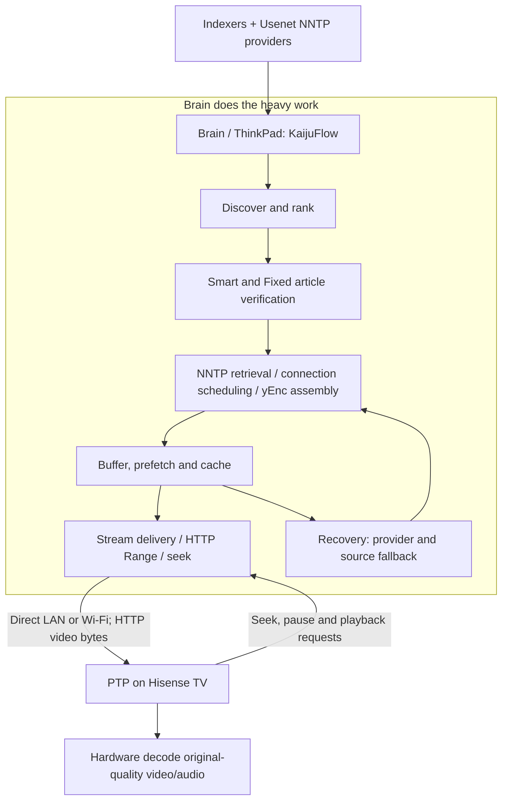

# ACTIVE A4 CHECKPOINT — executed new tests (2026-11-07)

**Source of truth:** [A4 additional synthetic CI report](A4-ADDITIONAL-SYNTHETIC-2026-11-07.md). Audit-only code head `1699e435af9a41f7f0f243a652fcc5def1a798dd` was independently executed in GitHub Actions [A4 42369608369](https://github.com/ReyesPascal/KaijuFlow/actions/runs/42369608369): **six synthetic.mjs cases PASS, two FAIL desired safety invariants** (single delete and delete-all). Separate original React stale-autosave success response remains intentionally RED, previously verified. Node20 [42369608375](https://github.com/ReyesPascal/KaijuFlow/actions/runs/42369608375) PASS; evidence validator [42369608614](https://github.com/ReyesPascal/KaijuFlow/actions/runs/42369608614) PASS. Recheck CI after this documentation commit.

**New verified:** A4-DELETEALL-007 failed 503 DELETE is not retried on immediate replay (attempt count 1→1), while missing token and invalid manifest cause zero remote DELETE; A4-PROVIDER-005 CRUD/reorder PASS using in-memory callbacks; A4-INDEXER-006 manual indexer CRUD/timeout/URL normalization/caps callback PASS; A4-NNTP-HANDSHAKE-008 original test endpoint PASS against fake 200/381/281 AUTHINFO socket on loopback. This is not real provider/indexer syncing, Smart/Fixed article verification, or throughput.

**Next tasks, in order:** (1) real synchronized indexer pathways; (2) Smart and Fixed article/STAT/provider fallback; (3) archive/yEnc parsing; (4) HTTP Range 200/206/416, cache and proxy/fallback. Extend `tests/a4/synthetic.mjs` or add bounded test files wired into existing sealed CI; avoid repeating passed tests. Record exact CI runs and findings. Keep intentionally RED behavior findings untouched. **Never modify original source or Brain production, merge PR #1/#3, use live NNTP/indexer credentials, or disable the isolation gate.**

**Resume prompt:** Resume KaijuFlow from Issue #2 and the top of NEXT_SESSION.md. Verify latest audit branch CI; continue outstanding A4 synchronized indexer, Smart/Fixed STAT and provider, archive/yEnc, Range/cache/fallback tests in the isolated GitHub-hosted fixture. Preserve source, existing red findings, and both unmerged PRs; save small evidence commits.

---

# ACTIVE NEXT-SESSION HANDOFF — finish remaining A4 quickly (2026-11-07)

**User direction:** Focus exclusively on completing and validating the remaining KaijuFlow A4 work as efficiently as safely possible. Do not surface or carry forward previously discussed optional architecture concepts in progress reports, priorities or future-session prompts. Historical handoffs below are retained only as provenance; this section overrides them.

## Independently verified current GitHub state
- PR #1 open/unmerged: `import/upstream-v1.4.1@c83a3c733b6394eb140a1c0a1dc500010a9f22e5`, targeting unchanged `main@1d35e9088f7abb5a8b907605b4b06a8960557540`.
- PR #3 open/draft/unmerged: `audit/node20-a3-baseline@3021941c86afed3b31026683feda4490c128cf52` when checked; new documentation commit will advance this head.
- On that audit head, evidence index [42368490168](https://github.com/ReyesPascal/KaijuFlow/actions/runs/42368490168) PASS and Node20 build [42368490167](https://github.com/ReyesPascal/KaijuFlow/actions/runs/42368490167) PASS. A4 [42368490134](https://github.com/ReyesPascal/KaijuFlow/actions/runs/42368490134) FAILED as expected due to original behavioral safety invariants. Do not treat intentionally red tests as environment-isolation failure; inspect logs if outcomes change.
- Immutable original source retained; all changes are audit/test/docs/evidence only.

## Completed — do not repeat
- A4-ISO-000 fail-closed disposable namespace/egress denial; JWT/auth A4-HTTP-001; Stremio SDK route A4-SDK-002; backend sequential settings subcase.
- Expanded A4-DELETE-003 tests: path traversal, bad packs/envelopes, invalid manifest, concurrency executed. **Two original defects remain test-observed and intentionally RED:** destructive HEAD; unsuccessful WebDAV DELETE marked deduplicated for immediate replay.
- Actual original `useAppConfig` React hook executed under isolated CI [42368292063](https://github.com/ReyesPascal/KaijuFlow/actions/runs/42368292063): 300ms debounce PASS; HTTP 500 and rejected transport response retain local edits PASS; **response-order safety invariant FAIL** — old successful PUT response overwrites shared `config` with stale cacheTTL=9300 after newer 9400, while local edit remains 9400. This is verified synthetic client-state behavior, not proof of server persistence order. [Finding](../../../evidence/findings/F-KF-A4-AUTOSAVE-001.md), evidence IDs `EV-KF-A4-REACT-004`, `CL-KF-A4-REACT-RACE-004`, `ART-KF-A4-REACT-004`. Do not rebuild or rerun solved static A3/import for redundancy.

## Fastest safe next sequence
1. Extend current isolated `tests/a4/synthetic.mjs` with **delete-all 503 replay** using fake localhost WebDAV. Distinguish expected red source behavior from fixture failures; record request count and auth/validation boundaries.
2. Add **provider CRUD/reorder + synced-indexer** synthetic fixtures against original compiled handlers, while preserving existing fail-closed gate.
3. Add **Smart/Fixed and provider NNTP** fixtures using fake Article/STAT responses and invented test credentials; no external host connections.
4. Add **archive/yEnc** synthetic fixtures and **NzbDAV HTTP Range 200/206/416, cache, fallback/proxy** cases. Prefer compact bounded increments, one committed checkpoint per tested group.
5. Check new-head CI and exact job logs after changes; write source-pinned results to `docs/kaijuflow/audit/` and evidence-index JSONL, run validator, leave failures visibly red. Update Issue #2 with each verified gate. Keep a fresh top-of-file handoff and exact resume prompt.

**Safety:** Never change original `src/` or `ui/src/`, working Brain production, containers, volumes, secrets, credentials or networking. No live NZBs, provider connections, PR merges, force pushes, or production deployment. Separate source fixes require approval.

**Resume prompt:** Resume KaijuFlow from Issue #2 and the top of `docs/kaijuflow/audit/NEXT_SESSION.md`. Verify audit head/CI; continue A4 delete-all 503 replay, then provider/sync, Smart/Fixed NNTP, archive/yEnc, Range/cache/fallback in isolated synthetic CI. Move quickly, use incremental verified GitHub checkpoints, keep original source and production unchanged and both PRs unmerged. Do not redo completed A3 or React work.

---

# CURRENT A4 CHECKPOINT — actual React hook race independently reproduced (2026-11-07)

- **Executed** actual original React `useAppConfig` under disposable, fail-closed network namespace in [GitHub Actions run 42368292063](https://github.com/ReyesPascal/KaijuFlow/actions/runs/42368292063), job `128390937109`. Original source SHA256 before/after unchanged.
- Actual hook mounted with React test renderer and virtual timers: **A4-REACT-300 PASS**, **A4-REACT-ORDER FAIL desired ordering invariant** (two successful cacheTTL PUT response completions reversed: local 9400 but config 9300), **A4-REACT-500 PASS** local edit retained/error logged, **A4-REACT-TRANSPORT PASS** local edit retained/error logged. This is **test-observed client state race**, not a production incidence or persisted backend overwrite. Details: [F-KF-A4-AUTOSAVE-001.md](../../../evidence/findings/F-KF-A4-AUTOSAVE-001.md).
- A4 backend/auth/SDK and expanded deletion cases still reproduce earlier outcomes, with original HEAD/503 problems intentionally RED. New two-report CI artifact ID `13572687206`, ZIP SHA256 `9841987a4f2f86853e7ba0f74a108fa20f165a114b1e68776a5a4ab56d5d38ff`. Red combined CI is appropriate; independent job logs show neither isolation nor hook harness failed.
- Added only `tests/a4/react-autosave.cjs`, isolated runner/CI wiring, and evidence; no edits to `src/` or `ui/src/`, no production actions, merges, secret or real NZB use. The React runtime fixture uses ephemeral dependency install **before** gate and original hook import **after** gate.
- **Next task:** synthetic failed delete-all WebDAV retry/dedup replay, then provider CRUD/reorder, synced indexers, Smart/Fixed NNTP, archive/yEnc, HTTP Range 200/206/416, cache/fallback. Keep tests isolated and source unchanged. Explicit owner approval required before fixes.
- Preserve design target: ThinkPad/Brain does discovery, NNTP retrieval/assembly, buffering/cache/fallback; PTP/Hisense does playback UI and hardware decode over direct LAN/Wi-Fi. Benchmark NzbDAV against alternatives; do not assume new engine implemented.

---

# CURRENT VERIFIED A4 CI — expanded deletion assertions executed (2026-11-07)

- Independent GitHub Actions log review of [A4 run 42367643808](https://github.com/ReyesPascal/KaijuFlow/actions/runs/42367643808), job `128388981743`, at audit head `f1c75cefbdb62a896e6563e41ef11e028dcebeff`: isolation gate PASS; HTTP/auth PASS; SDK PASS; backend sequential settings PASS; A4 deletion intentionally RED due to **HEAD invoking remote DELETE** and **503 failed DELETE deduplication**.
- **Expanded deletion edge cases are now CI-executed, not pending**: traversal/deep-pack/malformed inputs caused zero extra remote DELETEs, invalid manifest yielded 404/zero DELETE, four concurrent same-key requests issued exactly one remote DELETE.
- Permanent exact metrics and CI artifact identity: [A4-DELETE-003-CI-VERIFICATION.md](A4-DELETE-003-CI-VERIFICATION.md). New audit-only commits advance PR #3, so verify its head and evidence-index/Node20 checks again.
- **Next actual implementation**: isolated React `useAppConfig` hook fixture with controlled 300/500ms timers, deferred/inverted-order mock PUT replies, 500 and transport failure cases; then delete-all 503 replay, provider/sync, Smart/Fixed NNTP, archive/yEnc, Range 200/206/416, cache/fallback. These remain unexecuted. Do not report React concurrency as passed.
- Keep original source pristine, preserve the intentional red behavioral findings, and retain Brain-heavy original-quality retrieval/buffering with TV hardware decode as **design**, not deployed functionality. Both PRs remain unmerged; Brain production untouched.

---

# NEXT SESSION — A4 continuation and Brain-first streaming architecture (2026-11-07)

**Live state verified at save:** audit PR #3 OPEN/DRAFT and UNMERGED at `8275ffd2fb2ae507f78ef7631fad604b86afc554`; import PR #1 OPEN/UNMERGED at immutable `c83a3c733b6394eb140a1c0a1dc500010a9f22e5`. Original upstream source is unchanged. This handoff commit will advance PR #3, so fetch the new head and CI next session.

## Immediate A4 restart
- A4-ISO-000 proven in GitHub Actions run 42366142956: disposable network namespace, loopback only, IPv4/IPv6 TCP and DNS outbound denied, fail-closed negative probe stops application imports. Existing synthetic authentication A4-HTTP-001, Stremio SDK A4-SDK-002, and sequential backend settings subtest PASSED.
- A4-DELETE-003 intentionally RED on originally observed safety invariants: HEAD on a destructive GET route initiates fake WebDAV DELETE; simulated 503 is marked handled for 30 seconds. Independent review: `docs/kaijuflow/audit/A4-DELETE-003-REVIEW.md` and `evidence/findings/F-KF-A4-DELETE-001.md`. Additional deletion assertions were committed in `tests/a4/synthetic.mjs` (traversal, invalid pack depth, malformed token, invalid manifest, four concurrent same-key requests). **Do not claim the added assertions passed until latest CI results independently confirm.** Delete-all error dedup is currently a source-supported hypothesis, not a runtime observation.
- Original React `ui/src/hooks/useAppConfig.ts` uses 300/500ms delayed autosaves; successful responses call `setConfig(data)`, errors leave local state. React timer overlap, out-of-order response, 500 rejection and retry/rollback scenarios remain untested. Existing backend sequential tests do not establish React concurrency correctness.
- **Next action sequence:** verify current branch CI/index integrity; diagnose only newly added deletion assertions (keep discovered source defects visibly RED); build isolated actual React-hook timer/inflight/failure fixture; then A4-PROVIDER-005 and A4-SYNC-006; then synthetic Smart/Fixed NNTP, archive/yEnc, Range 200/206/416, cache/fallback and proxy cases. Save source-linked evidence/index records and GitHub commits, track independently executed vs source-observed vs proposed. No repeat of import/A3 AST/Node20 baseline.

## User-requested Brain-heavy / TV-light architecture recap (design target, not implementation claim)

- Today: working Usenet Ultimate + NzbDAV baseline on Brain, PTP on Hisense, direct LAN/Wi-Fi without Tailscale proved materially more stable in earlier playback observation. The architecture above is a **proposed KaijuFlow optimization target**. Do not claim planned NNTP prefetch, direct-stream engine or replacement is implemented.
- Keep NzbDAV until measured alternative wins on startup, sustained 4K bitrate, seek behavior, buffering, recovery, RAM/CPU and maintenance. Prefer original-quality passthrough and TV hardware decoding; Brain offloads discovery, network retrieval, assembly and buffering, **not necessarily video decoding/transcoding**. KaijuNNTP separate engine only with objective evidence.
- Brain / production Docker, NzbDAV volumes, passwords, networks and deployment are strictly off-limits without explicit approval. No PR merges, source rewrites, live NZBs/credentials, REA crossover or force push.

## Exact next-session prompt
> Resume KaijuFlow from GitHub Issue #2 and docs/kaijuflow/audit/NEXT_SESSION.md. Verify the current audit PR #3 head and A4 CI. Preserve the original source and both unmerged PRs. Complete expanded deletion assertions and React autosave concurrency in the proven isolated test environment; then continue remaining A4 synthetic cases. Save GitHub evidence/index checkpoints. Keep the Brain-heavy original-quality streaming design as a future benchmarking target, without touching Brain production.

---

# CURRENT A4 CONTINUATION — deletion review and expanded regression committed (2026-11-07)

**Verified live PR #3 head at session start:** `0d4f229a395e9ac2ea8eedd67585f13c6c41456d`; audit-only follow-up commits `f838c16f` (test expansion) and `ef72f276` (independent review). **Recheck current head and latest GitHub Actions before claiming execution.** Both PR #1 and draft PR #3 remain unmerged; immutable original baseline `c83a3c73` untouched.

- Independent source review recorded at [A4-DELETE-003-REVIEW.md](A4-DELETE-003-REVIEW.md). Source-confirmed: implicit HEAD on destructive GET route and pre-result 30s dedup on single and delete-all routes. Delete-all repeated-failure implication remains a **hypothesis** pending synthetic execution.
- Expanded existing network-isolated runner `tests/a4/synthetic.mjs` to check traversal, invalid pack depth, malformed envelope, invalid manifest and four simultaneous same-key requests. Existing destructive HEAD and failed 503 invariants deliberately remain red. **New checks have not yet been verified by CI at this checkpoint.**
- Previous independently executed A4-ISO-000 gate/auth/SDK/settings and deletion failures remain documented below and in run 42366142956; do not rerun the already settled static import/AST/Node20 work.
- **Immediate next:** check branch CI for `f838c16f` and later heads; diagnose only new failing assertions; then implement actual React hook 300/500ms debounce/inflight response-order/failure harness with virtual timers and fake HTTP inside proven namespace. Only after that, work through A4-PROVIDER-005, A4-SYNC-006, NNTP Smart/Fixed, archives and 200/206/416 ranges. No premature claim of React test completion, live streaming parity or security remediation.
- Preserve audit/index evidence and update Issue #2; original app source, Brain production, credentials, real NZBs, and both PR merges remain off limits.

---

# CURRENT A4 CHECKPOINT — isolated runtime gate verified / synthetic tests observed

**Date:** November 7, 2026. **Branch:** `audit/node20-a3-baseline`; verify live PR #3 head/CI because this checkpoint itself advances commit. **Source identity:** imported `c83a3c733b6394eb140a1c0a1dc500010a9f22e5` unchanged. **Both PR #1 and PR #3 remain open/unmerged.**

**Completed A4-ISO-000 and bounded HTTP tests, not full A4 parity:**
- [A4-ISO-000 report](A4-ISO-000.md), gate independently observed in GitHub-hosted [run 42366142956](https://github.com/ReyesPascal/KaijuFlow/actions/runs/42366142956): network namespace with only loopback, IPv4/IPv6 TCP and DNS denied, synthetic localhost reached, negative-control exit 77 blocked app import, pinned original source before/after hashes identical. All app code ran only after gate inside a disposable sandbox as an unprivileged user. No Brain/production access.
- Original auth router A4-HTTP-001 PASS. Actual locked SDK getRouter with dual mounts A4-SDK-002 PASS. Original backend settings router A4-AUTOSAVE-004 **backend-only subcase PASS** (disk/memory in sync for sequential valid PUT; invalid JSON 400 and oversized 413); **UI autosave timers, race/500 remain untested**.
- **A4-DELETE-003 failed desired safety invariants.** Original `GET /library-delete` Express handling triggered one fake WebDAV DELETE upon HEAD; a failed fake 503 DELETE was deduplicated on immediate retry. Reproduced with real original placeholder video assets in sandbox. See [F-KF-A4-DELETE-001](../../../evidence/findings/F-KF-A4-DELETE-001.md). The combined workflow is **RED intentionally** due to behavior failure, not isolation failure.
- Report artifact ID `13571527662`, ZIP SHA256 `0773c69cc29381259e9cf11d004a851bfecc4a09b9bcd5283ccb070ea04d9857`, expires about Nov 21. Permanent synthetic harness + report + finding + evidence index saved in Git. CI evidence-validator status must be rechecked after new commit.
- Codex and Claude Sonnet Medium completed earlier A3 source reviews; **not run during this A4 continuation**.

**NEXT:** Preserve the behavior finding as test-observed, no unauthorized source fix. Strengthen deletion HEAD/503/TTL/concurrency regression tests and independently review the safety impact; implement UI-hook 300/500ms autosave/race/rollback with fake HTTP/controlled time, and then provider/sync, Smart/Fixed, archive and Range/fallback fixtures inside the same network-denied runner. Do not rerun previous AST/Node20 import work, run REA via agents, modify Brain, merge PRs, or alter original app code. Explicit owner approval before future application-source changes and production activity.

---

# CURRENT CHECKPOINT — A3-ROUTE-003 complete as a bounded static pass / A4 design prepared

**Date:** November 7, 2026. **Latest audit head:** read live GitHub PR #3; this handoff itself advances the head. **Source:** c83a3c733b6394eb140a1c0a1dc500010a9f22e5 unchanged.

Completed this session:
- Source-only typed callback analyzer tools/audit/extract_callback_edges.cjs and .github/workflows/a3-callbacks.yml. [GitHub Actions run 42363448497](https://github.com/ReyesPascal/KaijuFlow/actions/runs/42363448497) PASS: 38 frontend files, 261 selected callback prop bindings (261 child parameters), 167 hook-return origins, 22 dynamic URL expressions, 0 parser errors/source modifications. This is bounded static relation mapping, NOT 603 complete transitive event-to-network chains. Detail: [A3-ROUTE-003.md](A3-ROUTE-003.md).
- Codex CLI 0.167.0 read-only ephemeral reviewed scoped App/useAppConfig source. Claude Code 2.1.319 Sonnet 5.5 Medium reviewed selected source excerpts with tools disabled; findings crosschecked against original source. Neither agent read REA, Fusion, related project materials, credentials or live configuration. No original files or production services modified.
- Source-confirmed provider callback pass-through HealthChecksOverlay/UltimateFallbackOverlay -> ProviderManager -> POST provider reorder with optimistic state; timed autosave hook and synced-indexer immediate POST plus debounced PUT. Runtime races and HTTP failure outcomes untested.
- [A4_ISOLATED_TEST_PLAN.md](A4_ISOLATED_TEST_PLAN.md) and [tests/a4/cases.json](../../../tests/a4/cases.json): 12 synthetic scenario specifications including A4-ISO-000, auth, SDK routes, GET/HEAD deletion, autosave, providers, Smart/Fixed, archive, Range and fallback. **No A4 app boot, network-denial validation or behavioral test executed.**
- Evidence/index/ manifest, claims, artifacts and subsystem links updated with source-pinned provenance. Validate new commit via evidence-index CI; do NOT declare new head CI passing without checking.
- PR #1 remains open/unmerged into main; draft PR #3 open/unmerged into import branch. Private repos; original 192 upstream file blobs/modes unchanged by audit. Brain production status read-only healthy prior to these doc/code changes.

**NEXT ACTION:** Verify PR #3 current head and CI. Resolve any validator finding without re-running import/AST/Node20 unnecessarily. Then IMPLEMENT THE A4-ISO-000 fail-closed, disposable network-namespace/mock fixture harness on isolated CI only and prove it prevents egress. Only after the gate passes, execute A4-HTTP-001, A4-SDK-002, A4-DELETE-003 and A4-AUTOSAVE-004 against synthetic services. Never use production credentials, real NZBs/NNTP, Brain containers, Docker volumes, networking or live streaming. No merge or deployment without owner approval.

---

# KaijuFlow — authoritative next-session handoff (2026-11-07)

**Checkpoint scope:** A3-ROUTE-002 source-only static inventory **delivered and indexed**; runtime behavior, complete cross-module React callback reachability, and A4 synthetic fixtures **not** complete. The older handoffs below this section are retained as history, not active directions.

## Verified GitHub ground truth
- Private repositories remain private. KaijuFlow import commit `c83a3c733b6394eb140a1c0a1dc500010a9f22e5` retains the upstream v1.4.1 baseline; original source bytes were not touched by this audit.
- PR [#1](https://github.com/ReyesPascal/KaijuFlow/pull/1) still targets `main` and is **open/unmerged**. Draft PR [#3](https://github.com/ReyesPascal/KaijuFlow/pull/3) targets `import/upstream-v1.4.1`; do not merge either without owner approval.
- Audit branch: `audit/node20-a3-baseline`. Read this handoff, `docs/kaijuflow/audit/A3-ROUTE-002.md`, `docs/kaijuflow/audit/A3-ROUTE-002-AST.md`, `docs/kaijuflow/audit/A3-ROUTE-002-SDK.md`, `evidence/README.md`, `evidence/index/{manifest,claims,artifacts}.jsonl`, and GitHub Issue #2 before starting. Branch head should be verified live each session; do not rely on historical SHA as current.
- Previously verified independent Node 20 build was already completed. **Do not rerun imported source validation or previously completed builds without a specific new reason.**

## Completed A3-ROUTE-002 evidence
1. **Original-source TypeScript AST:** [run 42361312353](https://github.com/ReyesPascal/KaijuFlow/actions/runs/42361312353) PASS, parser 5.9.3: **38 UI files**, **105 backend TS files**, **603 JSX event props** (520 inline), **64 UI network sites** (22 dynamic expressions), **40 effect registrations**, **64 explicit Express declarations including SPA catch-all**, **105 mutation candidates**, and **0 syntax parse errors**. Source diff check compared app source to the immutable import and passed. The script `tools/audit/extract_route_graph.cjs` is committed; AST projection `docs/kaijuflow/audit/A3-ROUTE-002-AST.md` is permanent. **Do not claim 603 complete callback-to-API edges; syntactic discovery does not prove inter-module transitive reachability.** A prior report's unverified '17 same-file reaches' count was removed.
2. **Route/auth/persistence tracing:** `docs/kaijuflow/audit/A3-ROUTE-002.md` maps selected React control handlers to API routes, legacy and /stremio/ manifest-key mounts, UI autosave → settingsUpdater → atomic tmp+rename for `config/config.json`, indexer/provider updates, auth/manifest `config/users.json`, ready/dead NZB caches, UF/fallback state, startup/signal writes, and GET-triggered WebDAV DELETE with 30s in-memory dedup. These remain **source observations**, not demonstrated runtime security bugs or 4K parity.
3. **Exact installed Stremio SDK inspection:** [run 42362133211](https://github.com/ReyesPascal/KaijuFlow/actions/runs/42362133211) **PASS** on `stremio-addon-sdk@1.6.10`, 10 JS files AST-parsed with zero errors. `src/getRouter.js:9` installs CORS, `:38` declares GET dynamic-prefix manifest, and `:49` declares GET dynamic-prefix resource pattern `:resource${ResourcesRegex}/:type/:id/:extra?.json`. KaijuFlow mounts `getRouter(addon)` beneath both manifest-key prefixes. SDK `serveHTTP` routes are **not** app mounts. The exact AST forms are in `docs/kaijuflow/audit/A3-ROUTE-002-SDK.md`. Dynamic regex/prefix evaluation and HTTP behavior are not verified.
4. **Agents:** Claude Code 2.1.319, actual `claude-sonnet-5-5` at Medium, finished source-excerpt review with tools disabled; hypotheses were cross-checked against source, correcting false flags on CORS and NzbDAV `mergeParams: true`. Codex CLI 0.167.0 ran read-only ephemeral against only a 47-file original-source-only snapshot, produced trace observations but **no finished final review** before a timeout. No agent saw REA, Fusion, other projects, credentials or live config.
5. **Machine-readable ledgers:** `EV-KF-A3-ROUTE-002`, `EV-KF-A3-ROUTE-002-AST`, `EV-KF-A3-SONNET-REVIEW-001`, `EV-KF-A3-SDK-002`, 5 new source claim IDs (four app/one SDK), and 2 hashed audit artifact records. Original AST artifact ID `13569439504`, later SDK-inclusive artifact ID `13569588096` with ZIP SHA-256 `3dcfeaa731e845d78d3f7b37516f367da73db4653c3e00fa17ee347226fdd0db`. Both expire **2026-11-21**; scripts and compact source summaries remain in Git, so they can be reproduced. Validate new ledger revisions via `tools/audit/validate_index.py` and Actions; cite successful run rather than assuming success.

## Next-session priority and boundaries
- **Start at A3-ROUTE-003 / A4 planning**, *not* at A3-ROUTE-001/002 re-enumeration. Focus on unresolved React cross-file prop/hook callback-to-network edges, the 22 dynamic network URL expressions, and runtime SDK pattern matching under synthetic mocks, only if necessary for audit exit criteria.
- Prepare isolated A4 tests for auth and manifest mount precedence; GET/HEAD delete replay/atomic-dedup; autosave failure/concurrency; Smart/Fixed verification, NNTP health, archive inspection, NzbDAV/cache recovery, HTTP Range 200/206/416, and fallback. Use wholly disposable config, stubbed network endpoints, and enforce/test network denial **before any app execution**.
- Preserve working Brain deployment untouched: **never stop/restart/change Docker, volumes, configuration, credentials or networking without separate explicit approval**. No runtime execution against production, no REA scan mixed into agents, no PR merge, no source rewrite, no force-push.

## Session resume prompt

> Resume KaijuFlow from GitHub Issue #2 and `docs/kaijuflow/audit/NEXT_SESSION.md`. Verify current GitHub branch/PR/evidence state. A3-ROUTE-002 static source AST, Stremio SDK 1.6.10 routing inspection, and source-pinned persistent side-effect report are already completed; do **not** repeat them or the Node 20 build. Continue with A3-ROUTE-003 unresolved inter-module callback edges and A4 isolated mock planning, using Codex and independent Claude Sonnet Medium only against scoped source-only data. Commit to the existing evidence index with validated checkpoints. Do not modify Brain production, source baseline, or merge PRs.

---

# KaijuFlow — latest handoff: A3-ROUTE-001 source audit started

**Update:** 2026-11-07. This top section **supersedes the previous "not yet started" task status** preserved below. GitHub Issue #2 and PR #3 are authoritative for current heads and CI. Do not repeat completed tasks.

## Newly completed during this session

1. Re-verified both private repositories and PRs: `main@1d35e9088f7abb5a8b907605b4b06a8960557540`, import `c83a3c733b6394eb140a1c0a1dc500010a9f22e5`, draft audit PR #3 initially `26c7de7cd8d564dc3c51c4cb4d1718b1782406cf`; both PR #1 and PR #3 remain **open and unmerged**. Node 20 and evidence CI at initial head PASS; recheck latest audit CI after new commits.
2. **Stage 0 checkout established:** separate private authenticated clone detached at immutable import SHA; Git clean, exactly 200 tracked source files. Root lock SHA-256 `54c88ad99a24af5f0839ad6791eb965faad6c67d8a09a3763c9220008900ea0b`; UI lock SHA-256 `24adc3cc32afd193a7827186fe95a2dc45b28fcf9f0a02b7f9176ae0dc3bd1a0`. Git 2.53.0 / Node 22.22.1 / npm 9.2.0 on host. **No app started; network isolation gate pending for runtime**. No production change.
3. Read-only Brain status: existing Usenet Ultimate healthy; NzbDAV and Manifexus running. No production process, credential, container or network mutation.
4. Both existing agents discovered on Brain: Claude Code 2.1.319 and Codex CLI 0.167.0. A **47-file original-source-only** scratch snapshot was created outside working deployment, without audit docs, Git history, credentials or unrelated material. Codex performed a bounded `--sandbox read-only --ephemeral` three-file auth chain spot review that agreed with independent pinned source fetch. It did not write or call services; Claude not run.
5. **Delivered [A3-ROUTE-001](A3-ROUTE-001.md)**: first-pass 63 explicit route declarations, 21 representative UI/action chains, guard/mount order, cross-references and unknowns. Includes source-observed GET-based WebDAV delete flows, JWT query-token SSE and protected config reads. These are **source facts, not test-confirmed vulnerabilities or runtime parity**.
6. Evidence index updated: `EV-KF-STAGE0-001`, `EV-KF-A3-ROUTE-001`; `CL-KF-STAGE0-CHECKOUT-001`, `CL-KF-A3-ROUTE-001`, `CL-KF-A3-GET-DELETE-001`; six subsystem records cross-link route evidence. Canonical [index](../../../evidence/README.md) updated.

## First actions next session

- Verify the **latest PR #3 head and CI** (Node 20 baseline + evidence-index validator); if validation fails, diagnose the specific new evidence record rather than repeating builds or source import.
- Run the saved `tools/audit/validate_index.py` against the audit branch if CI cannot verify it; retain result in a new evidence entry, without touching production.
- Continue A3 as `A3-ROUTE-002`: TypeScript AST-confirmed `ui/src` fetch/callback graph and Stremio SDK/Express route methods. **Do not claim complete UI coverage from the first-pass table**. Trace durable config writes and file/cache mutation paths before any isolated runtime boot.
- Keep helper agents on source-only sanitized materials, without access to unrelated audit tooling or directories. Use Codex for mechanical graph extraction, Claude Sonnet at Medium effort if available for independent review. Do not delegate specialized artifact analysis to them.
- Build network-restricted synthetic A4 fixtures for manifest-key and WebDAV-delete flows, query-token SSE, Smart/Fixed verification and `200/206/416` Range/fallback; live streaming and 4K benchmarks remain deferred.
- No PR merges, force-push, production deployment or Brain container changes. Original source bytes and rollback branch are preserved.

---

## Previous checkpoint (historical)

# KaijuFlow — next session: begin A3 analysis

**Checkpoint date:** 2026-11-07
**Purpose:** Start source-level A3 whole-app audit without redoing the completed import checks, Node20 compile, REA installation discovery, or evidence-index setup. The *first executable analysis* has **not** yet started. This is the exact recovery/runbook.

## GitHub source of truth (verify again before acting)

| Item | Verified at handoff |
| --- | --- |
| Private main repo | `ReyesPascal/KaijuFlow` |
| Main planning checkpoint | `main@1d35e9088f7abb5a8b907605b4b06a8960557540` |
| Rollback | `archive/pre-upstream-import` retains original planning checkpoint |
| Upstream imported baseline | `import/upstream-v1.4.1@c83a3c733b6394eb140a1c0a1dc500010a9f22e5` |
| Upstream provenance | `DSmart33/Usenet-Ultimate` v1.4.1 @ `499efbdeb631b1b059f8aa70d07c12beaf504876` |
| Import PR | [#1](https://github.com/ReyesPascal/KaijuFlow/pull/1) — open, unmerged, targets `main` |
| A3 audit branch | `audit/node20-a3-baseline` |
| Audit PR | [#3](https://github.com/ReyesPascal/KaijuFlow/pull/3) — **draft**, open, unmerged, targets *import branch*, current head at time of handoff: see PR/GitHub because this document itself adds a commit |
| Tracking issue | [#2](https://github.com/ReyesPascal/KaijuFlow/issues/2) |
| KaijuNNTP | Private, not yet a separate implemented engine; no work here this session |

**Prior independent checks remain valid where their input SHA has not changed:** 192/192 pinned original upstream files match Git blobs/size/mode (including 14 binary assets); root MIT and ReyesPascal notices preserved. The imported original source remains unchanged on audit PR #3. Do not redo the whole import or merge without owner approval.

## What is done (do not repeat)

1. Import integrity and licensing review on [PR #1](https://github.com/ReyesPascal/KaijuFlow/pull/1); no import blockers identified. Security risks are **not** cleared by the import review.
2. Independent Node20 backend + UI npm ci/tsc/Vite build PASS: [run 42355054013](https://github.com/ReyesPascal/KaijuFlow/actions/runs/42355054013). The latest branch also ran a Node20 build [run 42358166971](https://github.com/ReyesPascal/KaijuFlow/actions/runs/42358166971) PASS. This is **compilation**, not application/playback verification.
3. A3 v0.1 13-subsystem static source map: [A3_STATIC_ARCHITECTURE.md](../A3_STATIC_ARCHITECTURE.md), still **partial**.
4. Independent deep-research assessment adopted, with corrections and original user-pasted report archived: [EXECUTION_PLAN.md](EXECUTION_PLAN.md) and [RESEARCH_REPORT_2026-11-07.txt](RESEARCH_REPORT_2026-11-07.txt).
5. Source-adjacent [`evidence/` index](../../../evidence/README.md): 13 subsystems, 5 evidence records, 8 claims, 3 artifact rows, schema, findings guideline, and pinned first finding [F-KF-SEC-001](../../../evidence/findings/F-KF-SEC-001.md) on `rejectUnauthorized: false`. The finding is **source-observed**, not demonstrated by attack, fixed or runtime-tested.
6. Read-only source/index validation script `tools/audit/validate_index.py` and [index CI run 42358166881](https://github.com/ReyesPascal/KaijuFlow/actions/runs/42358166881) **PASS** on the latest pre-handoff audit head (29 index records); recheck CI after this handoff change.
7. Existing REA/Ghidra **found, not reinstalled:** REA `6.8.0` in `/home/ryan/fusion-android-analysis/rea-runtime/bin/rea-agents`; isolated Node `v24.22.2` in `/home/ryan/fusion-android-analysis/tools/node-v24.22.2-linux-x64/bin/node`; Ghidra 12.1.4 under Fusion `tools/`. `rea-agents --version` exited zero. **No REA KaijuFlow application analysis has yet run**.
8. No actual A4 synthetic NNTP/NzbDAV/Range or 4K benchmark yet. Unverified outcomes remain explicit in the evidence index.

## Start of next session: exact order

**0. Read this checkpoint, the evidence index and current Issue #2.** Read current PR #1 and PR #3 metadata/heads/CI. If GitHub has advanced, reconcile rather than overwriting new work.

**1. Verify isolation before executing code.** Brain Tunnel has been confirmed operational, but host shell commands require local owner review for *each exact command*, even with user approval for development. Check `brain_status` without changes. Do not touch running containers or production volume, credentials, networks or installed app versions.

**2. Establish source checkout properly.** The previously explored `/home/ryan/kaijuflow-a2` contains saved import scripts/manifests/logs, **not a Git repository**. Do not run `git worktree add` inside it. Use an existing verified separate clone if one is found, or create a fresh **private authenticated clone** to a new directory after checking it does not exist and does not overlap production or Fusion. Select the immutable import commit `c83a3c733b6394eb140a1c0a1dc500010a9f22e5` for code analysis. Never print saved Git credentials.

**3. Record reproducible environment identity.** `git rev-parse HEAD`, `git status --porcelain`, source/lockfile SHA-256, node/npm/REA versions, build commands, output directories. Backend `dist/` comes from `tsconfig.json`, and frontend `ui/dist/` comes from `ui/vite.config.ts`. Inspect actual emission before any REA `--source-path` selection.

**4. Begin **Stage 1 canonical source analysis** before REA.** First bounded work unit: extract exact Express/Stremio route mounts in `src/server.ts` / `src/addon/index.ts`, `src/routes/*`, and corresponding UI `ui/src` API invocation points; create a route/control/auth/side-effect table with exact pinned file/symbol/line anchors. Expand to Smart/Fixed coordinator and NNTP provider relationships next. Distinguish parsed static edges from inferred runtime behavior. Use TypeScript compiler API/ts-morph and dependency-cruiser where helpful, never edit original upstream source files just for annotations.

**5. Write findings immediately into the established index** (`evidence/index/{subsystems,manifest,claims,artifacts}.jsonl` and `evidence/findings/`), including unknowns, source SHA, exact anchors, code/build artifact digest, tool/version, claim classification, contradictions, severity and revalidation status. Use `python3 tools/audit/validate_index.py`; review CI on the audit branch. Only commit sanitized docs, scripts, tests and small summaries. Keep raw REA Evidence outside the repository under an access-controlled, **backed-up** dedicated evidence root with SHA-256 and explicit retention.

**6. Stage 2 after source-map progress:** compile source in the isolated checkout (original lockfiles; no production environment). Use existing REA 6.8.0 with its *separate* Node 24 runtime and observed `--format json`, `--detail summary`, `--evidence_output`, `--source-path` syntax. Start with a bounded backend artifact pilot (Smart/Fixed and NNTP verification, then NzbDAV/stream/fallback). Record coverage/limits; do not treat tool exit 0 as complete analysis or static candidates as runtime truth. Ghidra is only for a proven material native binary.

**7. Stage 3/4 later:** develop fake Newznab/NNTP/NzbDAV/WebDAV + isolated browser fixtures, error/cancellation/seek/cache tests; reserve production-impacting 4K benchmarks and any NzbDAV replacement/deploy for a separately approved gate.

## Next-session first actionable target

**Deliverable A3-ROUTE-001:** a complete first-pass **UI control → HTTP route → handler → external I/O/persistent side effect** matrix, plus coverage and open-question ledger, source-pinned to the unchanged imported commit. Begin by mapping `src/server.ts`, `src/routes/*`, `src/addon/index.ts`, `ui/src/App.tsx` and the UI hooks. Commit **only added audit files or scripts** on `audit/node20-a3-baseline` and keep PR #3 draft.

If local private clone/auth is blocked, make useful progress through the GitHub connector's source-file inspection and commit the first bounded source map. Do not block all of A3 on a new local tool installation.

## Safety, permissions and rollback

User has authorized isolated dev analysis/installation where needed, but **not** restarts, changes or redeployments of the working Brain services. Brain Tunnel still imposes approval for each exact shell command. There is no permission to merge either PR, change live Docker/volumes/network, introduce production credentials, force-push, move original source paths, or modify upstream bytes during this baseline.

Proven source rollback points: `main@1d35e908...` and `archive/pre-upstream-import`; PR #3 is review-only and can be closed without production change. Preserve both repos private.

## Suggested next user message

> Resume KaijuFlow from Issue #2 and the A3 next-session runbook. Verify current GitHub state; begin Stage 0 isolated checkout verification and deliver A3-ROUTE-001 (UI→route→handler→side-effect matrix) with evidence-index entries. Do not repeat prior import/build/index work, merge PRs, or change Brain production. Use the existing REA only after source-map progress.
